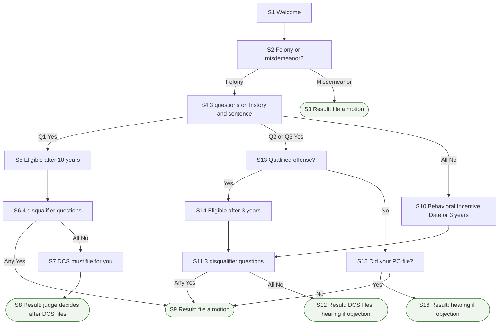

# Georgia Early Termination Tool

A bilingual (English and Spanish) web tool from REFORM Alliance that helps people on probation in Georgia understand how they can seek early termination. It applies only to probation, not parole. A person answers a short series of questions and reaches one of five results.

Part of REFORM Alliance's early termination tools: **Georgia** · [Florida](https://github.com/REFORM-Alliance/florida-early-termination-tool) · [Illinois](https://github.com/REFORM-Alliance/illinois-early-termination-tool) · [Virginia](https://github.com/REFORM-Alliance/va-implementation-tool) · [Pennsylvania Act 44](https://github.com/REFORM-Alliance/act-44-flow-chart-app).

## What it tells people

- **Misdemeanor:** no automatic process. The person may file a motion with the court at any time (Ga. Code 42-8-37, or 42-8-103 for pay-only probation).
- **Felony:** eligibility is reached after 10 years (lifetime probation for a sexual felony), after 3 years, or within 60 days of a Behavioral Incentive Date set at sentencing. The screens say which applies.
- **When eligible:** the Department of Community Supervision must file with the court, or the probation officer may choose to file. A judge then decides, holding a hearing if the prosecutor or judge objects.
- **Disqualifying answers** (an arrest, restitution owed, a revocation and similar) lead to the motion-only result.

## How the flow works

The tool is a scripted question-and-answer flow. A person answers one screen at a time, their answers choose the next screen, and a result screen says what they can do. Screens are numbered in the order a person meets them; each screen's code ID is its `question_id` in `app.R` (listed below the diagram).

Rounded boxes are result screens. "DCS" is the Department of Community Supervision. Multi-question screens (S4, S6, S11) send a person on according to their combined answers.

Screen numbers and code IDs

| Screen | `question_id` |
| --- | --- |
| S1 | `intro_page` |
| S2 | `initial_question` |
| S3 | `misdemeanor_result` |
| S4 | `felony_q1` |
| S5 | `felony_q1_yes1_result` |
| S6 | `felony_q1_yes1_questions` |
| S7 | `required_early_term_file_message` |
| S8 | `required_early_term_file_result` |
| S9 | `no_automatic_process_result` |
| S10 | `felony_q1_no_result` |
| S11 | `time_on_probation_questions` |
| S12 | `required_early_term_file_result_2` |
| S13 | `qualified_offense_question` |
| S14 | `automatic_3_year_eligibility_message` |
| S15 | `automatic_3_year_eligibility_po_question` |
| S16 | `early_term_possible_hearing_result` |

## Repository layout

| File or folder | What it is |
| --- | --- |
| `app.R` | The whole app: packages, the `decision_tree` list (every screen and its routing), page layout and server logic. |
| `json/translation.json` | English-to-Spanish text pairs. The English text is the lookup key. |
| `www/reform-logo-charcoal.png` | The logo at the top of the page. Shiny serves everything in `www/` as-is. |
| `renv.lock`, `renv/`, `.Rprofile` | Pinned package versions. `.Rprofile` switches renv on when the project opens. |
| `manifest.json` | App type, R version and packages, as read by Posit Connect when deploying. |
| `georgia-early-termination-tool.Rproj` | The RStudio project file. The app finds `json/translation.json` relative to it. |

The pinned versions are R 4.5.0 with the packages in `renv.lock`. The app loads `shiny`, `tidyverse`, `shinythemes`, `shinyWidgets`, `shinyjs`, `shinyalert`, `shiny.i18n`, `lubridate`, `scales`, `here`, `rsconnect` and `googleLanguageR`. The last two are loaded but never called, so no Google or hosting credentials are needed to run it.

## Run it locally

1. Install R 4.5.0 and the RStudio desktop app.
2. Clone or download this repo and double-click `georgia-early-termination-tool.Rproj`. RStudio opens the project and renv switches on by itself.
3. In the R console, run `renv::restore()` once. It installs the pinned package versions.
4. Open `app.R` and click **Run App**, or run `shiny::runApp()` in the console.
5. Switch the language picker to Spanish and click through every route you changed.

## Edit wording, questions and Spanish

- Each screen is one block in the `decision_tree` list at the top of `app.R`: `question_id` (its name), `question` or `result` (the text), `choices` (the answer buttons) and `next_question` (where each answer leads).
- After changing any English text, make the matching change to the `"en"` value in `json/translation.json` and rewrite its `"es"` value. Matching is exact, including punctuation and curly quotes, and text is translated in pieces around links and bold words. A miss shows that piece in English and logs a warning.
- Screen names must be unique and every name in `next_question` must exist, or Next does nothing. Keep the first screen as the welcome screen.
- Link to a statute with `tags$a(href='URL', target='_blank', class='external-link', "text")`. The `external-link` class triggers the "Leaving Application" confirmation.
- English and Spanish are written into the picker and the answer-lookup code in several places, so a third language needs code changes as well as a new column.

## Publish

The repo contains no deployment record, so it does not say where this tool is hosted. `manifest.json` is the file Posit Connect reads for Git-backed deployment; to publish from RStudio, connect the hosting account under Tools > Global Options > Publishing and use the Publish button with `app.R`, `json/` and `www/` ticked. Keep account tokens out of the repo.

After adding or upgrading a package, run `renv::snapshot()` and then `rsconnect::writeManifest()`, and commit both files so `renv.lock` and `manifest.json` stay in step.

## Known issues

Found by reading the code; the app was not run. Confirm each before changing anything.

- Result screens show a **Finish** button that looks for a `finished_page` screen this tool does not define, so it does nothing and there is no Start Over (Florida and Illinois use Start Over).
- S4 question 1 defines a "sexual felony" by Ga. Code 16-5-21, a section titled Aggravated assault. Confirm the intended section.
- S7 names the "Georgia Department of Community Safety" in one paragraph and Department of Community Supervision in another.
- Typos in user-facing text: "Georiga" (welcome), "Reiew" (S7), "requird" (S8). Each is also a key in `json/translation.json`; fix both.

## Keep the sibling repos in step

The five early termination tools copy the same engine rather than sharing a package. A fix to how the app behaves, as opposed to what it says, should be repeated in the other repos.
